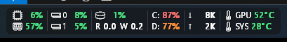

# Windows System Status Monitor

[English](README.md) · [Tiếng Việt](README.vi.md)

A tiny status strip that lives **on the Windows taskbar**: CPU, RAM, GPU, disk, partitions, network and
temperatures at a glance, with a hover tooltip for the details. One small native executable, no installer,
no administrator rights.



## What it shows

| Item | Details |
|---|---|
| CPU, RAM | Usage % |
| GPU 0 / GPU 1 | Usage % per graphics adapter (numbered in DXGI adapter order). NVIDIA through NVML, other adapters through Windows performance counters |
| Disk | Active time %, read / write speed in MB/s |
| Partitions | Used % of every fixed drive (or only the ones you list in the config); each can be hidden separately |
| Network | Download / upload (KB/s, MB/s or Kbps, Mbps) over the active physical adapters |
| Temperatures | NVIDIA GPU temperature, and the hottest ACPI thermal zone (`SYS`, **not** the CPU temperature, see [Temperatures](#temperatures)) |

Percentages turn green below 60 %, orange from 60 to 85 % and red above 85 %. Hovering the strip shows memory
used / total, drive sizes, link utilisation and temperatures.

## Requirements

- Windows 11, 64-bit. (Windows 10 has not been tested; the tray-icon mode is the likely fallback there.)
- No administrator rights and no extra runtime: the C runtime is linked statically.
- Optional, for NVIDIA GPU usage, memory and temperature: an NVIDIA driver (it provides `nvml.dll`).

## Install

1. Download `WindowsSystemStatusMonitor-vX.Y.Z-win-x64.zip` from the
   [Releases](../../releases) page.
2. *(Optional)* Verify it against `SHA256SUMS.txt` from the same release:
   ```powershell
   Get-FileHash .\WindowsSystemStatusMonitor-vX.Y.Z-win-x64.zip -Algorithm SHA256
   ```
3. Extract the zip to a folder you will keep, for example `C:\Tools\WindowsSystemStatusMonitor`.
   *Do not run it from inside the zip file.*
4. Run `WindowsSystemStatusMonitor.exe`. The strip appears on the taskbar.
5. To start it automatically: right-click the strip → **Start with Windows**.
   The entry stores the path of the executable, so **move the folder first, then enable it** (if you move
   the folder later, switch the option off and on again).

**Windows SmartScreen / antivirus warnings.** The executable is not code-signed. If SmartScreen says
"Windows protected your PC", choose *More info → Run anyway*. If you prefer not to trust a prebuilt binary,
[build it yourself](#build-from-source) — it is a single command.

## Uninstall

1. Right-click the strip → turn **Start with Windows** off, then choose **Exit**.
2. Delete the program folder.
3. Delete the settings folder `%APPDATA%\WindowsSystemStatusMonitor`.

## Usage

- **Hover** the strip for the detailed tooltip.
- **Right-click** the strip for the menu:
  - show / hide each item: CPU, RAM, GPU 0, GPU 1, disk active, disk read/write, each partition, network,
    GPU temperature, system temperature;
  - **Sample interval** (0.5 / 1 / 2 / 5 s), **Network unit** (bytes or bits);
  - **Poll NVIDIA GPU** — turn it off to stop all NVML access;
  - **Background** — the translucent rounded backdrop behind the strip;
  - **Start with Windows**, **Exit**.
- The strip sits at the **left** end of the taskbar by default, between the left edge and the Start / Search /
  app buttons, and falls back to the area left of the tray if there is no room there. When a side is too narrow,
  columns are dropped from the right: temperatures first, then network, partitions, disk and GPUs; CPU and RAM stay.
- `WindowsSystemStatusMonitor.exe --tray` forces tray-icon mode: one icon showing the CPU % whose tooltip
  lists everything. This mode is also used automatically on a vertical taskbar. On Windows 11 new tray icons
  start in the `^` overflow; drag the icon onto the taskbar or enable it under *Settings → Personalization →
  Taskbar → Other system tray icons*.
- Labels and icons are always white, and the strip draws its own dark backdrop so it stays readable on any
  taskbar colour. If you switch **Background** off on a light taskbar, white text is hard to read, so keep it on.

## Configuration

Settings are saved automatically when you use the menu. To edit them by hand, close the app first, then edit
`%APPDATA%\WindowsSystemStatusMonitor\config.ini` (section `[monitor]`):

| Key | Default | Meaning |
|---|---|---|
| `show_cpu`, `show_ram`, `show_gpu0`, `show_gpu1` | `1` | Show / hide the item |
| `show_disk`, `show_disk_rw` | `1` | Disk active time / read-write speed |
| `show_net` | `1` | Network |
| `show_temp_gpu`, `show_temp_sys` | `1` | GPU temperature / system (ACPI) temperature |
| `show_drive_C`, `show_drive_D`, … | `1` | Usage % of that partition letter |
| `drives` | *(empty)* | Empty = every fixed local drive. Set e.g. `D:,E:` to show only the system drive plus those |
| `background` | `1` | Translucent rounded backdrop and column dividers |
| `align` | `left` | `left` or `right`. If that side has no room the other one is used |
| `offset` | `0` | Move the strip inward by this many pixels |
| `interval_ms` | `1000` | Sampling interval (minimum 200) |
| `nvidia_polling` | `1` | `0` = never load `nvml.dll`; the NVIDIA GPU shows `off` |
| `net_bits` | `0` | `1` = Kbps / Mbps instead of KB/s / MB/s |

## Temperatures

- **`GPU`** is the NVIDIA GPU temperature read through NVML. It needs no administrator rights and disappears
  when `nvidia_polling` is `0`.
- **`SYS`** is the hottest Windows ACPI thermal zone (`\Thermal Zone Information(*)\Temperature`). On many
  machines this is a chassis or ambient sensor, **not the CPU die temperature**.
- **There is no CPU temperature.** Windows has no public API for it; reading it needs a third-party kernel
  driver and administrator rights, which this project deliberately avoids.

## Build from source

Requirements: Visual Studio or *Build Tools for Visual Studio* with the **Desktop development with C++**
workload (MSVC, x64). Nothing else is needed.

```bat
scripts\build.bat          :: builds build\WindowsSystemStatusMonitor.exe
scripts\build.bat test     :: builds build\sample_test.exe, which prints the sampled values to the console
```

The script finds the MSVC toolchain itself (through `vswhere`); inside an *x64 Native Tools Command Prompt*
it uses the environment that is already set up.

To produce the release assets (`dist\*.zip` and `dist\SHA256SUMS.txt`) see [docs/RELEASING.md](docs/RELEASING.md).

## How it works

- A background thread samples every source independently once per interval; a source that fails shows `N/A`
  and is retried a few seconds later, so one failing source never affects the others.
  CPU: `GetSystemTimes`. RAM: `GlobalMemoryStatusEx`. Disk, GPU engines and thermal zones: PDH counters.
  Adapters: DXGI. NVIDIA: NVML, loaded dynamically. Network: `GetIfTable2`, skipping loopback, tunnel and
  virtual adapters. Partitions: `GetDiskFreeSpaceEx`.
- The strip is a layered child window of the taskbar (`Shell_TrayWnd`), drawn into a 32-bit bitmap and
  composited with per-pixel alpha. The position of the Start / Search / app buttons is measured with UI
  Automation on a separate thread (UI Automation also walks the strip's own window, so calling it from the
  UI thread would deadlock).
- If the taskbar is restarted or changes, the window is recreated on the next timer tick.

## Known limitations

- There is no official API for placing content on the Windows 11 taskbar. This project relies on internal
  window classes of Explorer, so a future Windows update may break the strip; the tray-icon mode keeps working.
- Only the primary taskbar is supported. A vertical taskbar uses the tray-icon mode.
- Recovery after an Explorer restart is implemented but has not been verified.
- Tested on Windows 11 only; Windows 10 and light taskbars have not been tested.
- No CPU temperature (see [Temperatures](#temperatures)).
- The executable is not code-signed, so SmartScreen or antivirus software may warn about it.

## Troubleshooting

- **I do not see the strip.** Look for the tray icon (open the `^` overflow). The strip is hidden when no side of
  the taskbar has room for at least the CPU/RAM column: hide a few items from the menu, or free up space.
- **It overlaps another taskbar tool.** Increase `offset`, or set `align` to the other side.
- **GPU numbers do not match what I expect.** `GPU 0` / `GPU 1` follow the DXGI adapter order, which is not
  guaranteed to equal the numbering shown by every tool.
- **The NVIDIA GPU stays awake.** Whether polling NVML affects dGPU power saving has not been verified;
  set `nvidia_polling=0` (or switch **Poll NVIDIA GPU** off) to rule it out.
- **Settings seem to be ignored.** The file is read at start-up and rewritten on every menu change; edit it only
  while the app is closed.

## Footprint

Observed during development: about 8 MB of private memory with NVIDIA polling off, and roughly 27 MB with it on
(NVIDIA's `nvml.dll` is mapped into the process), with CPU use far below 1 % of a single core. Your numbers
will differ.

## Acknowledgements and license

The idea of placing a widget in the taskbar was inspired by
[Wireless-Device-Battery-Monitor](https://github.com/krisgfx9/Wireless-Device-Battery-Monitor) (GPL-3.0). No code
from that project is used; this implementation is original.

Released under the [MIT License](LICENSE).
