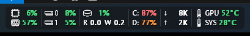

# Windows System Status Monitor

[English](README.md) · [Tiếng Việt](README.vi.md)

Một thanh trạng thái nhỏ hiển thị **ngay trên taskbar của Windows**: CPU, RAM, GPU, ổ đĩa, phân vùng, mạng và
nhiệt độ chỉ trong một cái nhìn, rê chuột vào để xem chi tiết. Chỉ một file thực thi nhỏ, không cần trình cài
đặt, không cần quyền quản trị.



## Hiển thị những gì

| Mục | Chi tiết |
|---|---|
| CPU, RAM | Phần trăm sử dụng |
| GPU 0 / GPU 1 | Phần trăm sử dụng của từng card đồ họa (đánh số theo thứ tự adapter DXGI). NVIDIA đọc qua NVML, các adapter khác qua bộ đếm hiệu năng của Windows |
| Ổ đĩa | Thời gian hoạt động (%), tốc độ đọc / ghi (MB/s) |
| Phân vùng | % dung lượng đã dùng của mọi ổ cố định (hoặc chỉ các ổ bạn liệt kê trong cấu hình); mỗi phân vùng bật/tắt riêng được |
| Mạng | Tốc độ tải xuống / tải lên (KB/s, MB/s hoặc Kbps, Mbps) trên các adapter vật lý đang hoạt động |
| Nhiệt độ | Nhiệt độ GPU NVIDIA và vùng nhiệt ACPI nóng nhất (`SYS`, **không phải** nhiệt độ CPU, xem mục [Nhiệt độ](#nhiệt-độ)) |

Các giá trị phần trăm có màu xanh dưới 60 %, cam từ 60 đến 85 %, đỏ trên 85 %. Rê chuột lên thanh để xem bộ
nhớ đã dùng / tổng, dung lượng ổ, mức sử dụng đường truyền và nhiệt độ.

## Yêu cầu

- Windows 11, 64-bit. (Windows 10 chưa được thử; nhiều khả năng sẽ dùng chế độ icon khay.)
- Không cần quyền quản trị, không cần cài thêm runtime: thư viện C được liên kết tĩnh.
- Tùy chọn, để đọc mức dùng, bộ nhớ và nhiệt độ GPU NVIDIA: driver NVIDIA (cung cấp `nvml.dll`).

## Cài đặt

1. Tải `WindowsSystemStatusMonitor-vX.Y.Z-win-x64.zip` ở trang
   [Releases](../../releases).
2. *(Tùy chọn)* Kiểm tra với `SHA256SUMS.txt` trong cùng bản phát hành:
   ```powershell
   Get-FileHash .\WindowsSystemStatusMonitor-vX.Y.Z-win-x64.zip -Algorithm SHA256
   ```
3. Giải nén vào một thư mục bạn sẽ giữ lâu dài, ví dụ `C:\Tools\WindowsSystemStatusMonitor`.
   *Đừng chạy trực tiếp từ bên trong file zip.*
4. Chạy `WindowsSystemStatusMonitor.exe`. Thanh trạng thái xuất hiện trên taskbar.
5. Để tự khởi động cùng Windows: chuột phải lên thanh → **Start with Windows**.
   Mục này lưu đường dẫn của file thực thi, nên **hãy di chuyển thư mục trước rồi mới bật** (nếu sau này đổi chỗ
   thư mục, hãy tắt rồi bật lại tùy chọn).

**Cảnh báo của Windows SmartScreen / phần mềm diệt virus.** File thực thi chưa được ký số. Nếu SmartScreen báo
"Windows protected your PC", chọn *More info → Run anyway*. Nếu bạn không muốn tin một file dựng sẵn, hãy
[tự build](#build-từ-mã-nguồn) — chỉ cần một lệnh.

## Gỡ cài đặt

1. Chuột phải lên thanh → tắt **Start with Windows**, rồi chọn **Exit**.
2. Xóa thư mục chương trình.
3. Xóa thư mục cài đặt `%APPDATA%\WindowsSystemStatusMonitor`.

## Cách dùng

- **Rê chuột** lên thanh để xem tooltip chi tiết.
- **Chuột phải** lên thanh để mở menu:
  - bật / tắt từng mục: CPU, RAM, GPU 0, GPU 1, disk active, disk read/write, từng phân vùng, mạng,
    nhiệt độ GPU, nhiệt độ hệ thống;
  - **Sample interval** (0.5 / 1 / 2 / 5 giây), **Network unit** (byte hoặc bit);
  - **Poll NVIDIA GPU** — tắt để ngừng mọi truy cập NVML;
  - **Background** — nền mờ bo góc phía sau thanh;
  - **Start with Windows**, **Exit**.
- Mặc định thanh nằm ở đầu **bên trái** taskbar, giữa mép trái và các nút Start / Search / ứng dụng, và tự chuyển
  sang vùng bên trái khay hệ thống nếu bên đó không đủ chỗ. Khi một phía quá hẹp, các cột được bỏ dần từ phải
  sang trái: nhiệt độ trước, rồi mạng, phân vùng, ổ đĩa và GPU; CPU và RAM được giữ lại.
- `WindowsSystemStatusMonitor.exe --tray` ép chạy chế độ icon khay: một icon hiện % CPU, tooltip liệt kê mọi
  thứ. Chế độ này cũng tự dùng khi taskbar nằm dọc. Trên Windows 11, icon mới nằm trong mũi tên `^`; hãy kéo
  icon ra taskbar hoặc bật trong *Settings → Personalization → Taskbar → Other system tray icons*.
- Nhãn và biểu tượng luôn màu trắng, và thanh tự vẽ nền tối riêng để đọc được trên mọi màu taskbar. Nếu bạn tắt
  **Background** trên taskbar sáng thì chữ trắng sẽ khó đọc, vì vậy hãy để nó bật.

## Cấu hình

Cài đặt được lưu tự động khi bạn dùng menu. Muốn sửa tay, hãy đóng ứng dụng trước, rồi sửa
`%APPDATA%\WindowsSystemStatusMonitor\config.ini` (mục `[monitor]`):

| Khóa | Mặc định | Ý nghĩa |
|---|---|---|
| `show_cpu`, `show_ram`, `show_gpu0`, `show_gpu1` | `1` | Hiện / ẩn mục |
| `show_disk`, `show_disk_rw` | `1` | Thời gian hoạt động của ổ / tốc độ đọc-ghi |
| `show_net` | `1` | Mạng |
| `show_temp_gpu`, `show_temp_sys` | `1` | Nhiệt độ GPU / nhiệt độ hệ thống (ACPI) |
| `show_drive_C`, `show_drive_D`, … | `1` | % dung lượng của phân vùng mang chữ cái đó |
| `drives` | *(trống)* | Để trống = mọi ổ cố định trong máy. Đặt ví dụ `D:,E:` để chỉ hiện ổ hệ thống cộng các ổ đó |
| `background` | `1` | Nền mờ bo góc và vạch ngăn cột |
| `align` | `left` | `left` hoặc `right`. Nếu phía đó không đủ chỗ sẽ dùng phía còn lại |
| `offset` | `0` | Dịch thanh vào trong bấy nhiêu pixel |
| `interval_ms` | `1000` | Chu kỳ lấy mẫu (tối thiểu 200) |
| `nvidia_polling` | `1` | `0` = không bao giờ nạp `nvml.dll`; GPU NVIDIA hiện `off` |
| `net_bits` | `0` | `1` = Kbps / Mbps thay cho KB/s / MB/s |

## Nhiệt độ

- **`GPU`** là nhiệt độ GPU NVIDIA đọc qua NVML. Không cần quyền quản trị và sẽ biến mất khi `nvidia_polling` là `0`.
- **`SYS`** là vùng nhiệt ACPI nóng nhất của Windows (`\Thermal Zone Information(*)\Temperature`). Trên nhiều máy
  đây là cảm biến vỏ máy hoặc môi trường, **không phải nhiệt độ lõi CPU**.
- **Không có nhiệt độ CPU.** Windows không có API công khai cho việc này; muốn đọc phải dùng driver kernel của
  bên thứ ba và quyền quản trị, điều mà dự án này cố ý tránh.

## Build từ mã nguồn

Yêu cầu: Visual Studio hoặc *Build Tools for Visual Studio* với workload **Desktop development with C++**
(MSVC, x64). Không cần gì khác.

```bat
scripts\build.bat          :: tạo build\WindowsSystemStatusMonitor.exe
scripts\build.bat test     :: tạo build\sample_test.exe, in các giá trị lấy mẫu ra console
```

Script tự tìm bộ công cụ MSVC (qua `vswhere`); nếu chạy trong *x64 Native Tools Command Prompt* thì dùng luôn
môi trường đã thiết lập sẵn.

Để tạo các file phát hành (`dist\*.zip` và `dist\SHA256SUMS.txt`), xem [docs/RELEASING.md](docs/RELEASING.md).

## Cách hoạt động

- Một thread nền lấy mẫu từng nguồn độc lập mỗi chu kỳ; nguồn nào lỗi sẽ hiện `N/A` và được thử lại sau vài
  giây, nên một nguồn lỗi không ảnh hưởng các nguồn khác.
  CPU: `GetSystemTimes`. RAM: `GlobalMemoryStatusEx`. Ổ đĩa, engine GPU và vùng nhiệt: bộ đếm PDH.
  Adapter: DXGI. NVIDIA: NVML, nạp động. Mạng: `GetIfTable2`, bỏ qua loopback, tunnel và adapter ảo.
  Phân vùng: `GetDiskFreeSpaceEx`.
- Thanh là một cửa sổ layered con của taskbar (`Shell_TrayWnd`), được vẽ vào bitmap 32-bit và ghép với alpha
  theo từng điểm ảnh. Vị trí các nút Start / Search / ứng dụng được đo bằng UI Automation trên một thread riêng
  (UI Automation cũng duyệt cả cửa sổ của chính thanh này, nên gọi từ UI thread sẽ bị deadlock).
- Nếu taskbar khởi động lại hoặc thay đổi, cửa sổ được tạo lại ở lần timer kế tiếp.

## Hạn chế đã biết

- Windows 11 không có API chính thức để đặt nội dung lên taskbar. Dự án dựa vào các lớp cửa sổ nội bộ của
  Explorer, nên một bản cập nhật Windows trong tương lai có thể làm hỏng thanh này; chế độ icon khay vẫn dùng được.
- Chỉ hỗ trợ taskbar chính. Taskbar dọc dùng chế độ icon khay.
- Việc tự phục hồi sau khi Explorer khởi động lại đã được lập trình nhưng chưa được kiểm chứng.
- Chỉ thử trên Windows 11; Windows 10 và taskbar sáng chưa được thử.
- Không có nhiệt độ CPU (xem mục [Nhiệt độ](#nhiệt-độ)).
- File thực thi chưa ký số, nên SmartScreen hoặc phần mềm diệt virus có thể cảnh báo.

## Xử lý sự cố

- **Tôi không thấy thanh.** Hãy tìm icon khay (mở mũi tên `^`). Thanh bị ẩn khi không phía nào của taskbar đủ chỗ
  cho ít nhất cột CPU/RAM: hãy ẩn bớt mục trong menu hoặc giải phóng chỗ.
- **Nó đè lên công cụ khác trên taskbar.** Tăng `offset`, hoặc đặt `align` sang phía còn lại.
- **Số GPU không như tôi mong đợi.** `GPU 0` / `GPU 1` theo thứ tự adapter DXGI, không đảm bảo trùng với cách
  đánh số của mọi công cụ.
- **GPU NVIDIA cứ thức.** Việc đọc NVML có ảnh hưởng tới chế độ tiết kiệm điện của GPU rời hay không chưa được
  kiểm chứng; hãy đặt `nvidia_polling=0` (hoặc tắt **Poll NVIDIA GPU**) để loại trừ.
- **Cài đặt dường như bị bỏ qua.** File được đọc khi khởi động và được ghi lại sau mỗi lần đổi menu; chỉ sửa
  khi ứng dụng đã đóng.

## Tài nguyên sử dụng

Quan sát trong quá trình phát triển: khoảng 8 MB bộ nhớ riêng khi tắt đọc NVIDIA, và khoảng 27 MB khi bật
(`nvml.dll` của NVIDIA được nạp vào tiến trình), mức dùng CPU thấp hơn nhiều so với 1 % của một lõi. Số liệu trên
máy bạn sẽ khác.

## Ghi nhận và giấy phép

Ý tưởng đặt widget lên taskbar được gợi từ
[Wireless-Device-Battery-Monitor](https://github.com/krisgfx9/Wireless-Device-Battery-Monitor) (GPL-3.0).
Không có mã nào của dự án đó được dùng; phần triển khai ở đây là mã gốc.

Phát hành theo [Giấy phép MIT](LICENSE).
